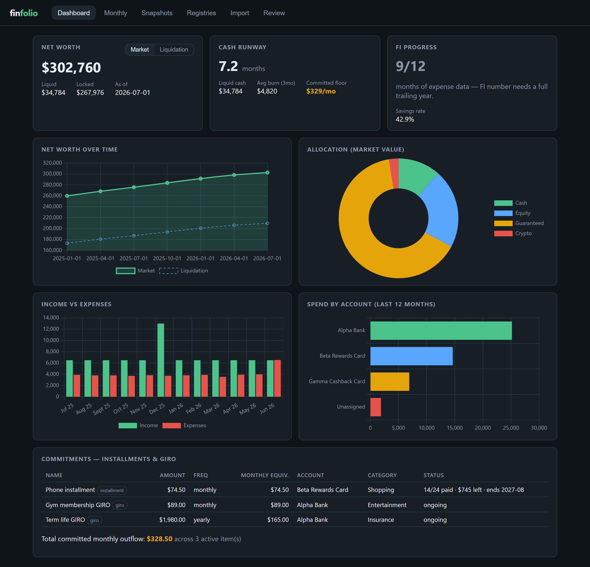
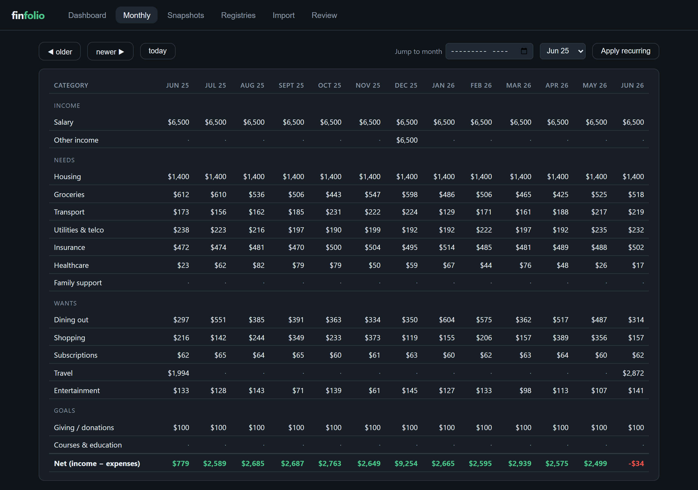

# finfolio

**Local-first personal finance dashboard: Node.js, no database, your data never leaves your machine.**

One page answers four questions: *Where does my money sit? How many months of runway do I have? How far to financial independence? Where does it go each month?* It also keeps a register of every installment plan and GIRO payment you're committed to. Bank and card statements (CSV, text PDF, or scanned PDF via on-device OCR) can be imported to backfill the numbers.



<sub>Captured from `npm run demo`, which serves generated, fictional sample data ("Alpha Bank", "Beta Rewards Card"). No real accounts or figures.</sub>

**Try it:** `npm install && npm run demo`, then open http://127.0.0.1:5177 (details in [Quick start](#quick-start)).
**Read the code:** [Architecture](#architecture) ·
[pure calculation core](public/js/calc.js) ·
[statement importer](lib/importer.js) ·
[per-bank PDF parsers](lib/pdf-profiles.js) ·
[tests](test/) (`npm test`, Node's built-in `node:test`, no test framework).

## Why it exists

Personal finance tools want your bank credentials, your data on their servers, or a subscription. finfolio wants none of that:

- **Local-only.** An Express server bound to `127.0.0.1`, a static frontend, and a folder of JSON files. No accounts, no telemetry, no cloud.
- **No database.** Your entire financial state is human-readable JSON you can open, diff, back up, or version yourself. Writes are atomic (temp file + rename) and every save keeps a `.bak` of the previous version.
- **Data is separate from code.** The app reads whatever directory `DATA_DIR` points at (default `./data`, gitignored). Point it at a synced folder, an encrypted volume, or your note vault — the repo never contains a real number.

## Requirements

**Node.js 18+.** That's it — no database, no compiler toolchain, no system libraries.
The PDF/OCR pipeline (`pdfjs-dist`, `@napi-rs/canvas`, `tesseract.js`) ships as prebuilt
binaries and WASM for Linux (glibc and musl/Alpine), macOS (Intel and Apple Silicon), and
Windows — `npm install` just works, with nothing to compile.

Don't have Node yet?

```bash
# macOS (Homebrew)
brew install node

# Linux (nvm — works on any distro, no root needed)
curl -o- https://raw.githubusercontent.com/nvm-sh/nvm/v0.40.1/install.sh | bash
nvm install --lts

# Windows
winget install OpenJS.NodeJS.LTS
```

## Quick start

```bash
git clone https://github.com/anothersummerofsleep/finfolio.git
cd finfolio
npm install
npm run demo     # explore with generated sample data (throwaway copy)
npm start        # real mode — starts empty, data lives in ./data
```

Then open http://127.0.0.1:5177. Set `DATA_DIR` and/or `PORT` to override defaults.

`npm run demo` copies the committed `sample-data/` into a gitignored `.demo-data/` folder
and serves that copy, so edits made while exploring never touch real data or the repo.
It also ignores any `STATEMENTS_DIR` set in your shell, so the demo never lists or
imports from a real statements folder.

Optionally point `STATEMENTS_DIR` at a standing local folder of downloaded statements
(subfolders welcome, e.g. one per bank) so the Import tab can list and import them
directly instead of the OS file picker every time. finfolio never deletes or edits files
there; the only write is an opt-in, one-file-at-a-time rename offered on the review
screen (for banks that download as `activity.csv`):

```bash
# PowerShell
$env:STATEMENTS_DIR = "C:\path\to\your\statements-folder"; npm start
# bash
STATEMENTS_DIR=/path/to/your/statements-folder npm start
```

## What it does

| Panel | Question it answers |
|---|---|
| **Net worth** | Total across sleeves (bank, brokerage, retirement, insurance products, crypto) with a **market ⇄ liquidation toggle** — because an insurance product can be "worth" $55k on paper and $13k if you actually need the money. |
| **Cash runway** | Liquid funds ÷ trailing average burn, with your **committed floor** (GIRO + installments) shown separately — the part of the burn you can't cut without cancelling something. |
| **FI progress** | Assets vs FI number (trailing-12-month expenses × 25). Refuses to guess until it has 12 real months of data. |
| **Income & expenses** | Monthly bars, category breakdown, and spend-by-card/bank for whatever you've tagged. |
| **Commitments** | Every installment (with remaining balance and payoff date) and standing GIRO, plus total committed monthly outflow. |

Data entry is designed around the reality that nobody logs transactions daily:

- **Monthly granularity.** One number per category per month, entered in an editable grid built for backfilling years quickly. A cell can be split across accounts when you care; left untagged when you don't.

  
- **Statement import.** Upload a bank/card **CSV** (map columns once per account), a **PDF e-statement** (a per-bank profile locates the transaction table), or an **image-only PDF** (some banks render statements as page images with no text layer — read on-device with OCR). Then review with auto-suggested categories and merge. The **review screen is fully editable** — date, description, and amount — which matters for OCR, where a digit can be misread. When a row came from OCR, a **📎 shows a crop of the exact source line** on hover, so a suspect amount can be checked against the actual statement without reopening the PDF. Categorization rules grow as you correct suggestions. Re-importing a month replaces that account's imported numbers and never touches manual entries. PDF profiles ship bank by bank; an unrecognized bank falls back to a generic profile you pick.
- **Review queue.** Transactions parsed cleanly but left uncategorized on purpose (a flight installment, a one-off foreign merchant, a fee) don't block an import — they land on their own **Review** tab, kept in `review-queue.json`, to be categorized whenever. Committing them **tops up** the affected month additively, so it never disturbs categories already recorded for that month.
- **Statements folder (optional).** Point `STATEMENTS_DIR` at a standing local folder of downloaded statements and the Import tab lists them (newest first) with a one-click Import, no browser file picker needed. finfolio never deletes or edits files there; the only write is an opt-in rename of one file to a suggested name.
- **Bulk import.** From the statements folder, select several PDF statements and import them in one pass (CSVs are still imported one at a time). Each PDF is read (OCR when it has no text layer), its bank is detected from the matching profile, the account is guessed from earlier imports of that bank, and results stream back file by file into a triage table before the rows land in the Review queue for a single categorization pass. A file that fails is reported without stopping the rest.
- **Optional PaddleOCR-VL engine.** Scanned statements are read with the bundled `tesseract.js` by default. If you run the optional local Python sidecar in [`sidecar/`](sidecar/README.md), imports use PaddleOCR-VL instead, which returns the transaction table as structured HTML; finfolio falls back to tesseract automatically whenever the sidecar is not running. Both run on your machine.
- **Apply recurring.** One click drops the month's expected GIRO/installment amounts into the grid — explicit, never automatic.

## Architecture

```
server.js            Express: static frontend + thin JSON API (localhost only)
lib/store.js         atomic JSON file store (temp+rename, .bak on every write)
lib/importer.js      CSV parsing, column mapping, categorization rules, merge
lib/pdf.js           PDF text extraction (pdfjs-dist) → positioned lines
lib/pdf-render.js    shared page rasterization (@napi-rs/canvas) for both OCR engines
lib/ocr.js           image-only PDFs: default OCR engine (tesseract.js)
lib/ocr-paddle.js    optional OCR engine: client for the local PaddleOCR-VL sidecar
lib/paddle-tables.js PaddleOCR-VL HTML tables → transactions
lib/pdf-profiles.js  per-bank statement parsers (one bank profile + generic fallback) → transactions
lib/batch.js         bulk-import helpers: account guess per bank, review-queue items
lib/statements.js    lists/resolves files under STATEMENTS_DIR (path-safe; opt-in rename only)
lib/seed.js          first-run defaults (categories, sleeves, settings)
public/js/calc.js    pure calculation module — shared by the UI and the tests
public/js/review-queue.js  the Review tab: deferred/uncategorized transactions
public/js/*.js       vanilla ES modules, one per tab; Chart.js for charts
sidecar/             optional Python PaddleOCR-VL server (not a dependency of the Node app)
test/                node:test suites for calc, importer, store, pdf, pdf-extract, ocr,
                     ocr-paddle, paddle-tables, batch, statements, demo-mode isolation
```

Dependencies: **Express** (server), **Chart.js** (charts), **pdfjs-dist** (PDF text
extraction), and — for image-only statements — **@napi-rs/canvas** (page render, a
prebuilt binary, no compile step) + **tesseract.js** (OCR, WASM). No build step, no
framework. Both OCR deps run on-device; tesseract downloads its ~15MB English model
once and caches it under `DATA_DIR` — nothing is sent off the machine.

Design choices worth noting:

- **No build step, no framework.** Vanilla ES modules; the whole app is readable in one sitting.
- **Pure calculation core.** Everything numeric (net worth series, runway, FI math, installment schedules, import merging) lives in dependency-free modules tested with `node:test` — the UI is just rendering.
- **OCR reuses the text path.** Rendered-then-OCR'd pages are turned into the *same* positioned-line shape as a text PDF, so the existing bank profiles parse them with no OCR-specific code. Image-only import is "render → OCR → existing pipeline."
- **OCR accuracy is fixed at the source, not patched after.** These statements sit an account-summary sidebar next to the transaction table, and Tesseract's column detection tends to merge the two — bleeding sidebar numbers into a transaction's amount. finfolio **crops the sidebar off before OCR** rather than trying to strip it back out afterward. The parsers are also OCR-tolerant where it's safe (a `CR` marker glued straight onto a number, a day glued to a month like `08Sep`) — but never in ways that could mask a misread. For the cases OCR can still get wrong, the **📎 source-line snippet** puts the actual pixels one hover away: rendered page images are cached under `DATA_DIR/.ocr-image-cache/` and cropped on demand by page + line position, so a transaction only needs to carry a tiny reference, not the image.
- **Import safety.** Parsing errors are reported, not silently dropped; uncategorized rows are never imported (they go to the Review queue instead); the review screen is editable so OCR misreads are corrected before merge; card-bill payments can be marked "skip" to avoid double counting.
- **Statements folder is path-safe and effectively read-only.** `lib/statements.js` only lists supported extensions and resolves a picked path with a traversal guard (`../` and absolute paths are rejected), so the server can't be tricked into reading outside `STATEMENTS_DIR`. finfolio never deletes or edits statement files; the one write is the opt-in rename, which goes through the same guard, sanitizes the new name, and never overwrites an existing file.

```bash
npm test         # run the test suite
npm run sample   # regenerate sample-data/ (deterministic, seeded PRNG)
npm run sample:pdf   # regenerate the fake sample bank statement PDF
```

## Roadmap

- More PDF statement profiles, one bank at a time (first profile shipped)
- Transaction-level drill-down (raw imports are already retained under `DATA_DIR/imports/`)
- Read-only integration with an Obsidian knowledge vault

OCR for image-only statements is **done** — render with @napi-rs/canvas, OCR with
tesseract.js, verify amounts in the editable review.

## License

[MIT](LICENSE). Use it, fork it, build on it.
